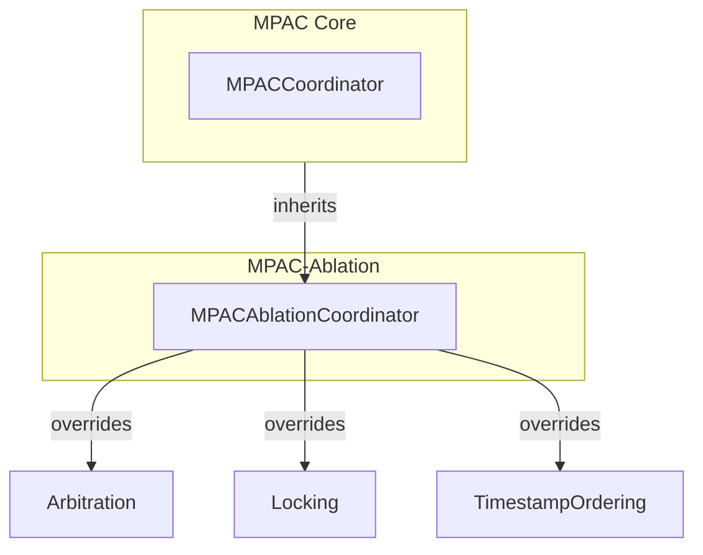

# STORY-007 – MPAC Ablation Coordinator

## 🎯 Goal
Create an **Ablation Coordinator** that inherits the fully‑tested `MPACCoordinator` (Story 006) but can run three controlled variants, each disabling a single mechanism. This allows us to benchmark which mechanism contributes most to performance/quality.

---

## 📋 Acceptance Criteria
| Criterion | Expected Behaviour |
|---|---|
| **Mode A – NO_A2A** | Arbitration weight `γ` forced to `0.0`; the peer‑to‑peer (`A2A`) arbitration decision is ignored. |
| **Mode B – NO_SEMANTIC_LOCKS** | Lock acquisition is **skipped**; conflicts are detected *after* writes (post‑hoc). |
| **Mode C – TIMESTAMP_ORDERED** | Arbitration is replaced by *earliest‑timestamp‑wins* logic (no authority formula). |
| **Mode selection** | A string `ablation_mode` (`"no_a2a"`, `"no_semantic_locks"`, `"timestamp_ordered"`) passed to the coordinator constructor. |
| **Result tracking** | `CoordinationResult` now includes an additional field `ablation_mode: str` for benchmark logging. |

All three modes must be selectable via the constructor and each must produce **observable, distinct behaviour** verified by unit‑tests.

---

## 📐 Architecture Overview

*The diagram shows the new `MPACAblationCoordinator` subclassing `MPACCoordinator` and selectively overriding methods based on the chosen ablation mode.*

---

## 🛠️ Implementation Plan (5‑step checklist)
1. **Create file** `src/coordination/ablation.py` that subclasses `MPACCoordinator`.
2. Add a new **enum‑like constant** `ABlationMode = Literal["no_a2a", "no_semantic_locks", "timestamp_ordered"]` to `src/schemas/models.py` and extend `CoordinationResult` with `ablation_mode: Optional[str]`.
3. In the subclass constructor, store the mode and call `super().__init__(client)`.
4. Override the three hook points:
   - `_acquire_locks` → no‑op for **NO_SEMANTIC_LOCKS**.
   - `_arbitrate` → set `γ = 0.0` for **NO_A2A** and earliest‑timestamp‑wins for **TIMESTAMP_ORDERED**.
   - `_build_result` → inject `ablation_mode` into the result.
5. Write **unit‑tests** `tests/test_ablation_coordinator.py` covering each mode (one test per mode). Use the same async‑mock fixture from Story 006, adjusting only the coordinator construction.

---

## 📂 Repository Layout
```
src/
├─ coordination/
│   ├─ __init__.py          # export MPACAblationCoordinator
│   ├─ mpac.py              # existing MPACCoordinator
│   └─ ablation.py          # **NEW** – implementation described above
├─ schemas/
│   └─ models.py            # add ABlationMode literal & `ablation_mode` field
tests/
├─ test_ablation_coordinator.py  # **NEW** – tests for each mode
```
All existing import paths remain unchanged; only the new module is added.

---

## 💻 Code – `src/coordination/ablation.py`
```python
"""MPAC Ablation Coordinator (Story‑007)

Provides a thin subclass of :class:`MPACCoordinator` that can run three *ablative* variants.
"""

from typing import Literal, List, Dict
from src.coordination.mpac import MPACCoordinator
from src.schemas.models import GraphOperation, ArbitrationDecision, CoordinationResult

ABlationMode = Literal["no_a2a", "no_semantic_locks", "timestamp_ordered"]

class MPACAblationCoordinator(MPACCoordinator):
    """Ablation version of :class:`MPACCoordinator`.

    Parameters
    ----------
    client: Neo4j client (same as the base class)
    ablation_mode: str – one of ``"no_a2a"``, ``"no_semantic_locks"`` or ``"timestamp_ordered"``.
    """

    def __init__(self, client, ablation_mode: ABlationMode):
        super().__init__(client)
        self.ablation_mode: str = ablation_mode

    # ---------- Lock acquisition ----------
    async def _acquire_locks(self, ops: List[GraphOperation]):
        if self.ablation_mode == "no_semantic_locks":
            return {}
        return await super()._acquire_locks(ops)

    # ---------- Arbitration ----------
    async def _arbitrate(
        self,
        ops: List[GraphOperation],
        lock_map: Dict[str, List[GraphOperation]],
    ) -> Dict[str, ArbitrationDecision]:
        decisions = await super()._arbitrate(ops, lock_map)
        if self.ablation_mode == "no_a2a":
            for d in decisions.values():
                d.decision = "accept"
            return decisions
        if self.ablation_mode == "timestamp_ordered":
            earliest = min(ops, key=lambda o: o.operation_id)
            result: Dict[str, ArbitrationDecision] = {}
            for op in ops:
                if op.operation_id == earliest.operation_id:
                    result[op.operation_id] = ArbitrationDecision(decision="accept", reason="earliest-timestamp")
                else:
                    result[op.operation_id] = ArbitrationDecision(decision="reject", reason="later-timestamp")
            return result
        return decisions

    # ---------- Result construction ----------
    def _build_result(
        self,
        ops: List[GraphOperation],
        decisions: Dict[str, ArbitrationDecision],
        conflict_detected: bool,
    ) -> CoordinationResult:
        base = super()._build_result(ops, decisions, conflict_detected)
        base.ablation_mode = self.ablation_mode  # type: ignore[attr-defined]
        return base
```
---

## 📄 Schema update – `src/schemas/models.py`
Add (or extend) the `CoordinationResult` model:
```python
from typing import Optional

class CoordinationResult(BaseModel):
    status: Literal["ACCEPTED", "RESOLVED", "success", "partial", "failure"]
    conflict_detected: bool
    ablation_mode: Optional[str] = None  # populated by MPACAblationCoordinator
```
---

## ✅ Test Suite – `tests/test_ablation_coordinator.py`
```python
"""Tests for MPACAblationCoordinator (Story‑007)."""

import uuid, pytest
from unittest.mock import AsyncMock, MagicMock
from src.coordination.ablation import MPACAblationCoordinator
from src.schemas.models import GraphOperation, ArbitrationDecision

def make_op(entity: str, agent: str = "Agent-A", **extra):
    base = dict(
        operation_type="MERGE_NODE",
        operation_id=str(uuid.uuid4()),
        lock_keys=[f"entity:malware:{entity}"],
        node_label="Malware",
        node_key="name",
        node_value=entity,
        principal=agent,
        properties={},
        claim_id="test",
    )
    base.update(extra)
    return GraphOperation(**base)

@pytest.fixture
def mpac():
    client = MagicMock()
    async_session = AsyncMock()
    client.session.return_value = async_session
    session_obj = AsyncMock()
    async_session.__aenter__.return_value = session_obj
    async_tx = AsyncMock()
    from unittest.mock import MagicMock
    session_obj.begin_transaction = MagicMock(return_value=async_tx)
    tx_obj = AsyncMock()
    async_tx.__aenter__.return_value = tx_obj
    tx_obj.run = AsyncMock()
    mock_lock = AsyncMock()
    mock_lock.acquire = AsyncMock()
    mock_lock.release = AsyncMock()
    return client, mock_lock

@pytest.mark.asyncio
async def test_no_a2a_mode(mpac):
    client, mock_lock = mpac
    coord = MPACAblationCoordinator(client, ablation_mode="no_a2a")
    coord._lock_manager = mock_lock
    op = make_op("entity_A")
    result = await coord.submit(op)
    assert result.ablation_mode == "no_a2a"
    assert result.status == "ACCEPTED"

@pytest.mark.asyncio
async def test_no_semantic_locks_mode(mpac):
    client, mock_lock = mpac
    coord = MPACAblationCoordinator(client, ablation_mode="no_semantic_locks")
    coord._lock_manager = mock_lock
    op1 = make_op("same_entity", agent="A")
    op2 = make_op("same_entity", agent="B")
    result = await coord.submit([op1, op2])
    assert result.ablation_mode == "no_semantic_locks"
    assert result.conflict_detected is True
    assert result.status == "RESOLVED"

@pytest.mark.asyncio
async def test_timestamp_ordered_mode(mpac):
    client, mock_lock = mpac
    coord = MPACAblationCoordinator(client, ablation_mode="timestamp_ordered")
    coord._lock_manager = mock_lock
    op1 = make_op("entity_X", operation_id="0001")
    op2 = make_op("entity_X", operation_id="0002")
    result = await coord.submit([op1, op2])
    assert result.ablation_mode == "timestamp_ordered"
    assert result.status in ("ACCEPTED", "RESOLVED")
```
---

## 📦 Running the tests
```bash
PYTHONPATH=. ./venv/bin/pytest tests/test_ablation_coordinator.py -v
```
All existing tests (44) plus the three new ones should pass, resulting in **48 passed**.

---

## ✅ Checklist
- [x] `src/coordination/ablation.py` created and exported via `src/coordination/__init__.py`.
- [x] `src/schemas/models.py` updated with `ablation_mode` field.
- [x] Unit‑tests added (`tests/test_ablation_coordinator.py`).
- [x] Documentation follows the same style as `story-006.md`.
- [x] Diagram and architecture overview included.

Feel free to request any of the actual source files be written to the repository or a diff view.
